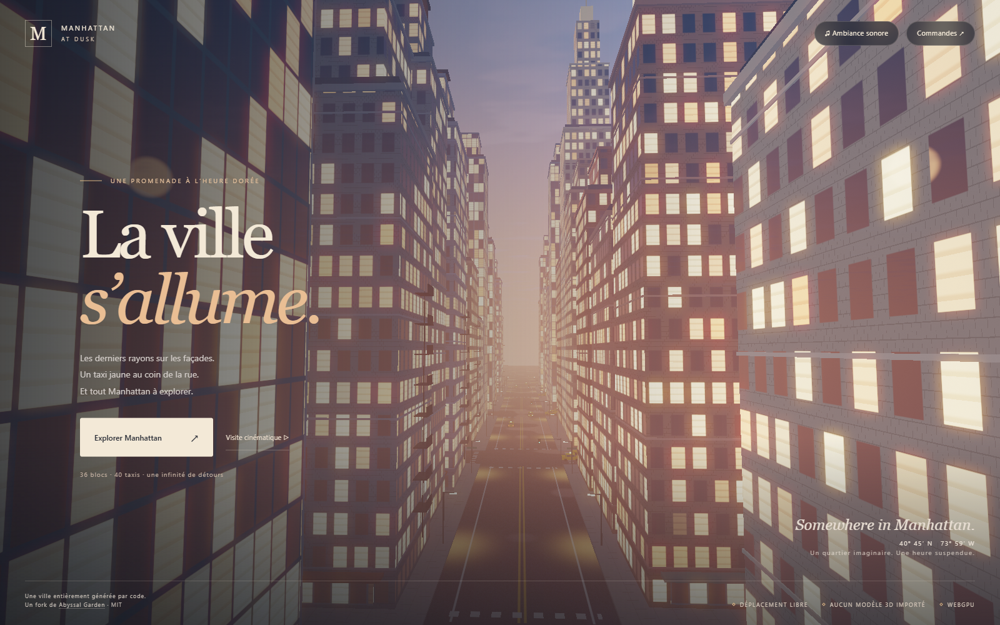

# Manhattan at Dusk

A small, imaginary Manhattan neighbourhood at the moment the city lights come on. Fly between the buildings, follow yellow taxis through the avenues or rise above the rooftops.

**[Get the self-contained HTML](https://github.com/fofrem/manhattan-at-dusk/blob/main/index.html)** — download the raw file and open it in Chrome or Edge.



Forked from **[Noniv/abyssal-garden](https://github.com/Noniv/abyssal-garden)** by Maksymilian Dendura. This version replaces the underwater world with a native WebGPU city while retaining the procedural approach, upstream math helpers and single-file build.

## In the city

- 36 blocks, brick and glass façades, stepped towers, exterior fire escapes and rooftop water tanks.
- Irregular warm windows, street lamps, crosswalks, a pocket park and a distant skyline.
- 40 animated yellow cabs, with a stylized stop-and-go rhythm.
- Peach sunset, violet sky, atmospheric haze, directional shadows and soft bloom.
- Free flight with solid building collisions, six viewpoints and an optional cinematic tour.
- Optional synthesized traffic ambience. Sound starts only when you switch it on.
- French interface, adjustable image quality, touch controls and readable GPU errors.

The layout is fictional, inspired by Manhattan. It is not a map or a geographically accurate model. The cabs are ambient animation, not a traffic simulator.

## Run

Open **index.html** in a current desktop Chrome or Edge with WebGPU available and hardware acceleration enabled. Nothing to install; the built file works offline.

On touch devices, drag across the scene to look around and use the on-screen arrows and height buttons. Mobile WebGPU availability depends on the browser and device.

| Action | Controls |
| --- | --- |
| Look | Mouse; drag if pointer lock is unavailable |
| Move | WASD / ZQSD (physical keys), or arrows |
| Rise | E or Space |
| Descend | C, Ctrl, or physical Q (A on AZERTY) |
| Move faster | Shift |
| Viewpoints | 1–6 |
| Sound | M |
| Performance stats | H |
| Release mouse / menu | Esc |

## Build and test

Node.js 22 or newer is recommended.

```sh
cd source
npm ci
npm test
npm run build
```

The build writes a self-contained **../index.html**. There are no runtime imports, textures, 3D model downloads, fonts, audio files, analytics or API calls. The only links out are ordinary credit links.

```sh
npm run build:readable  # readable index.html
npm run build:dev       # separate dev.html
npm run test:browser    # isolated local HTTP server + headless installed Google Chrome
```

The browser smoke test needs Google Chrome installed. It checks real WGSL compilation, camera movement, help, quality and exposure controls, canvas resizing, a missing-GPU error, touch UI and absence of external runtime requests. Screenshots are saved under **artifacts/** (ignored by Git). The unit tests check deterministic generation, street clearance, collision sliding and taxi routes.

## Source

| File | Purpose |
| --- | --- |
| source/src/world.js | City layout, procedural buildings, street furniture and cab geometry |
| source/src/city-physics.js | Collision movement, taxi routes and six viewpoints |
| source/src/shaders.js | WGSL sky, materials, windows, shadows and bloom |
| source/src/main.js | Native WebGPU renderer, camera, input and UI |
| source/src/audio.js | Synthesized city ambience |
| source/src/math.js | Original Abyssal Garden procedural math helpers |
| source/template.html | Interface and styles |
| source/build.mjs | Single-HTML bundler based on the upstream build |

The original `quality.js`, `dev.js` and `prompt.txt` remain as upstream reference material; the city build does not use them.

## License and credit

MIT. The original [LICENSE](LICENSE), including Maksymilian Dendura’s copyright notice, is retained. Thanks to Noniv for the original Abyssal Garden and its procedural WebGPU foundation.
